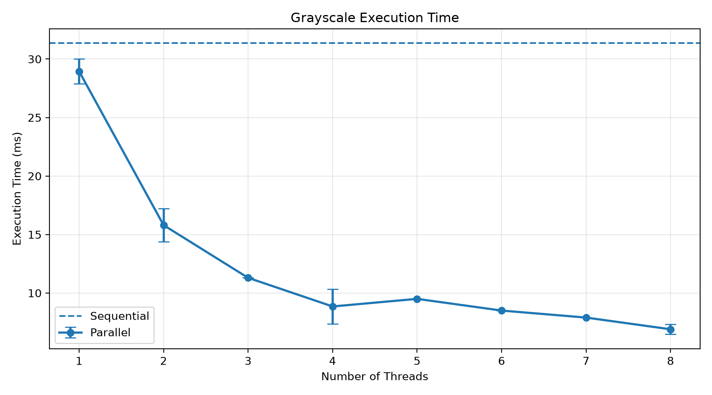
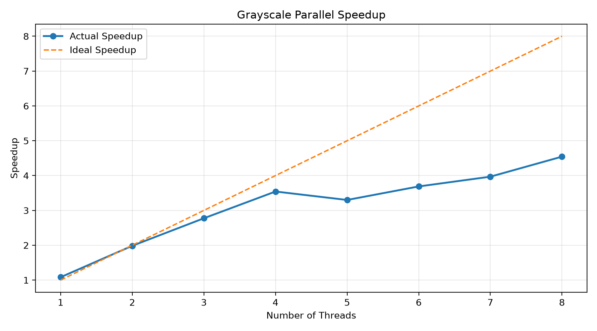

# Parallel-Image-Processing

A C project that applies image filters sequentially and in parallel
using **OpenMP**. It currently implements grayscale conversion and
benchmarks execution time with different thread counts.

## Features

-   Load and save images using `stb_image` and `stb_image_write`.
-   Apply grayscale conversion sequentially and in parallel.
-   Benchmark thread counts from 1 to 8.
-   Measure execution time, speedup, and parallel efficiency.
-   Check that sequential and parallel outputs are identical.
-   Save benchmark results in JSONL format.

## Project Structure

``` text
.
├── include/       # Header files and stb libraries
├── src/           # C source files
├── images/        # Input images and processed outputs
├── results/
│   ├── charts/    # Generated benchmark charts
│   └── benchmark_results.jsonl
├── scripts/       # Python plotting script
└── build/         # Compiled executable
```
> Generated using [Tree Printer](https://github.com/AmirmasoudCS/Tree-Printer.git)

## Compile

Run these commands from the project root:

``` powershell
New-Item -ItemType Directory -Force build
gcc -std=c11 -Wall -Wextra -O2 -fopenmp -Iinclude `
    src/main.c src/image.c src/filters.c src/benchmark.c src/stb_impl.c `
    -o build/image_processor.exe
```

## Run the Benchmark

Make sure the output and results directories exist, then run:

``` powershell
New-Item -ItemType Directory -Force images/output, results
.\build\image_processor.exe images/image1.jpg images/output/grayscale_benchmark.png
```

The program runs the sequential version and then the parallel version
with **1 to 8 threads**. It checks the outputs and appends the
measurements to:

``` text
results/benchmark_results.jsonl
```

## Generate Charts

After running the benchmark, generate the charts with:

``` powershell
python scripts/plot_results.py
```

The charts are saved in `results/charts/`.

## Example Results

The following charts show one benchmark run on an image with a
resolution of **3648 × 5472**.

### Execution Time



### Speedup



### Parallel Efficiency


