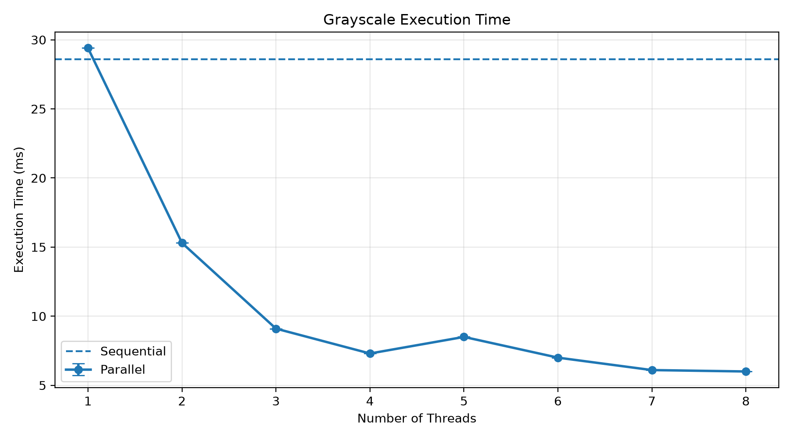
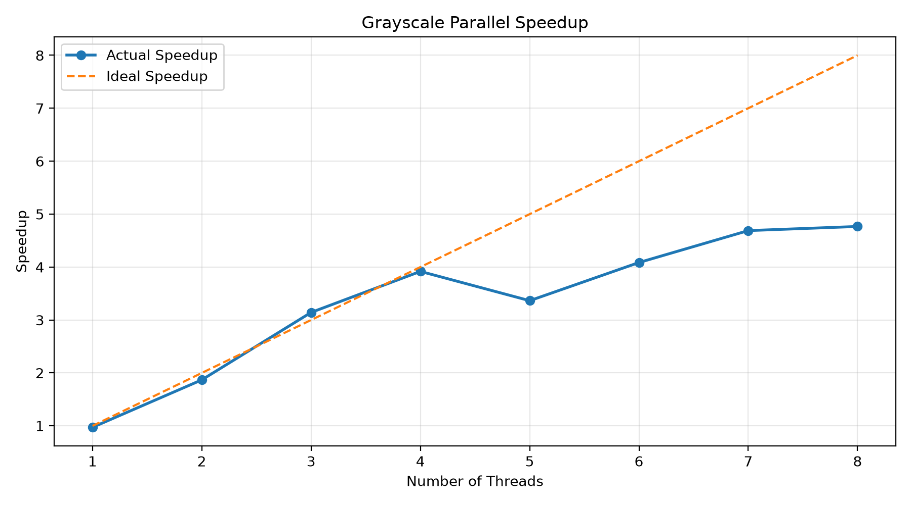
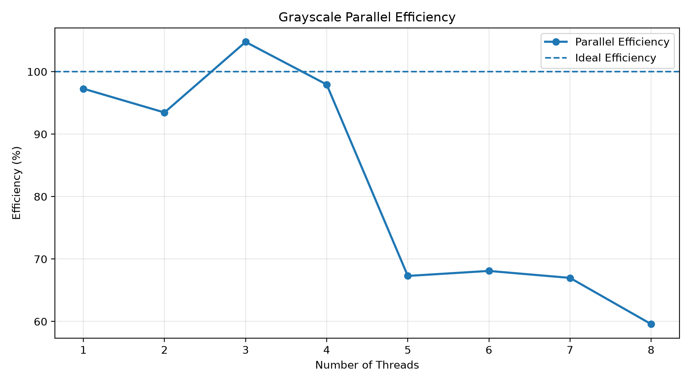
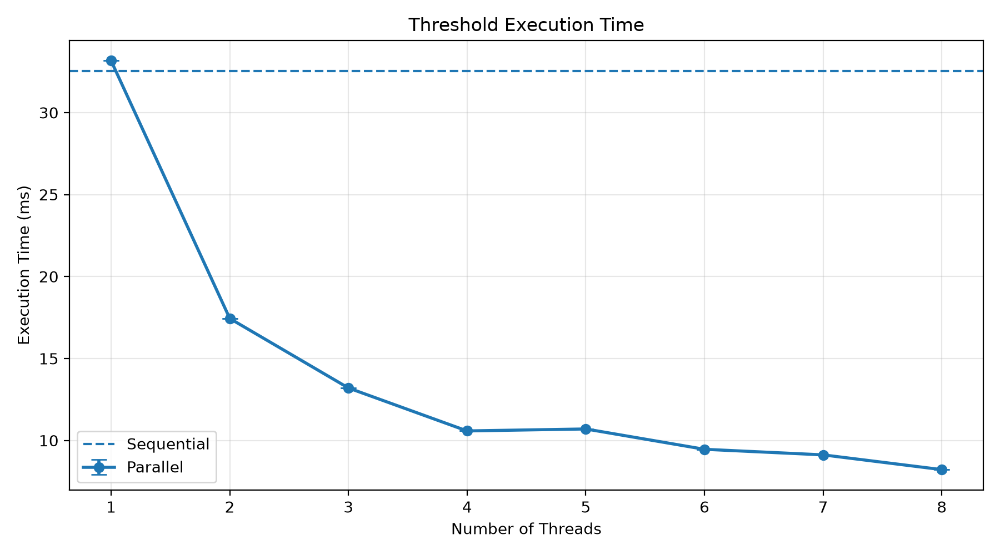
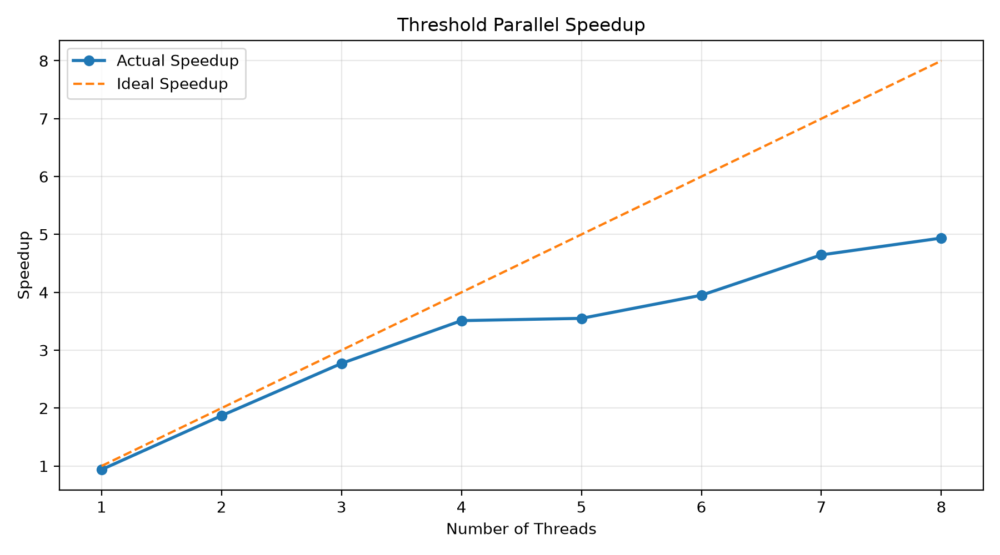
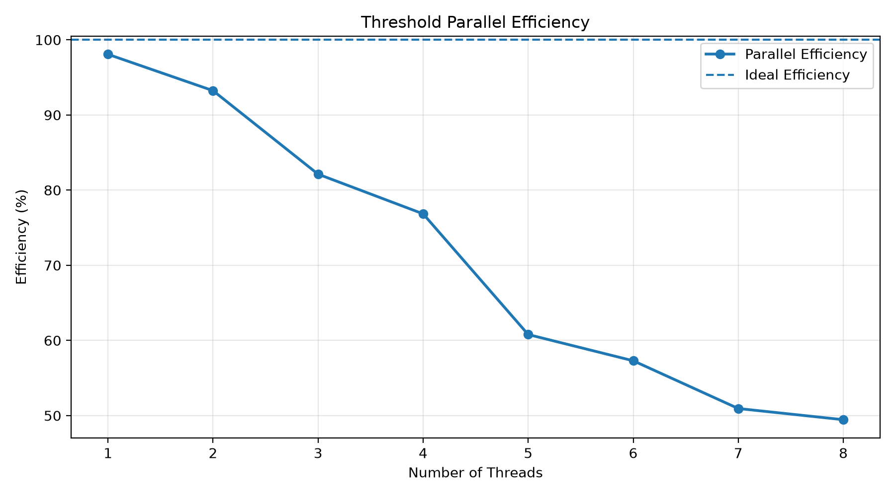
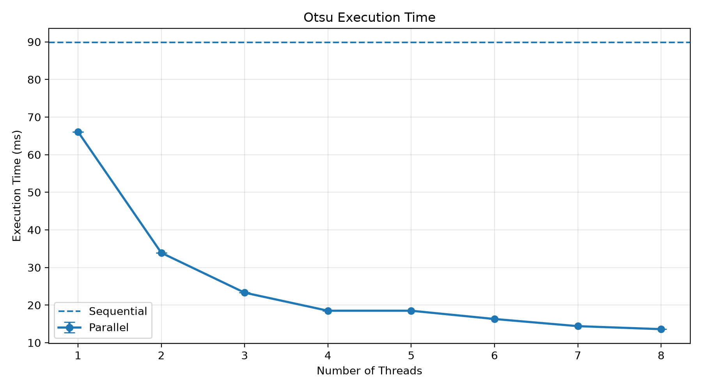
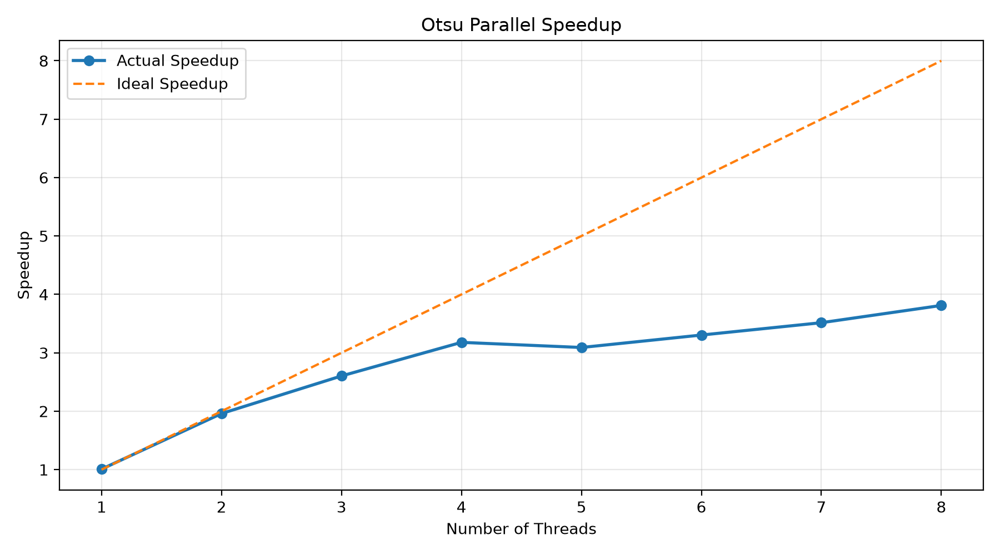
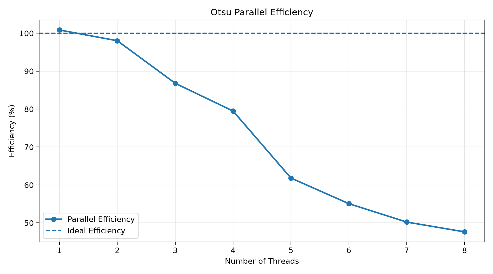

# Benchmark Results Analysis

## 1. Experimental Setup

The benchmarks compare sequential and OpenMP implementations of three image-processing operations:

- Grayscale conversion
- Fixed thresholding, using a threshold of 128
- Otsu's automatic thresholding

All operations were tested using the same RGB image with the following specifications:

| Property | Value |
|---|---:|
| Image width | 3648 pixels |
| Image height | 5472 pixels |
| Channels | 3 (RGB) |
| Total pixels | 19,961,856 |
| Repetitions | 50 |
| Thread configurations | 1 to 8 |

Each filter was benchmarked using both its sequential and parallel implementations.

To reduce measurement-order bias, sequential and parallel executions were measured in alternating order. The sequential baseline was calculated by averaging measurements across all eight thread configurations.

The following metrics were calculated:

- **Execution Time:** Average time required to complete the operation.
- **Speedup:** Ratio between sequential and parallel execution times.
- **Efficiency:** Speedup divided by the number of threads, expressed as a percentage.

The speedup and efficiency are calculated using:

$$
Speedup = \frac{T_{sequential}}{T_{parallel}}
$$

$$
Efficiency = \frac{Speedup}{Number\ of\ Threads} \times 100
$$

---

## 2. Results Overview

The following table summarizes the benchmark results.

### Sequential Execution Times

| Filter | Execution Time |
|---|---:|
| Grayscale | 28.43 ms |
| Fixed Threshold | 32.52 ms |
| Otsu | 67.07 ms |

### Best Parallel Results

| Filter | Threads | Execution Time | Speedup | Efficiency |
|---|---:|---:|---:|---:|
| Grayscale | 8 | 7.46 ms | 3.81x | 47.65% |
| Fixed Threshold | 8 | 8.22 ms | 3.96x | 49.45% |
| Otsu | 8 | 17.60 ms | 3.81x | 47.64% |

All three filters achieved their lowest execution time with eight threads.

---

## 3. Grayscale Conversion

### Execution Time

  
  
<em>Execution time of grayscale conversion using different numbers of threads.</em>

The sequential implementation takes approximately 28.43 ms.

Increasing the number of threads generally reduces execution time. With eight threads, the execution time drops to approximately 7.46 ms.

There is a small performance regression when moving from six to seven threads. Execution time increases from 7.98 ms to 9.10 ms.

This behavior can occur because adding threads does not always guarantee better performance. Thread scheduling overhead, CPU resource contention, and memory bandwidth limitations can affect execution time.

With eight threads, performance improves again, reaching the lowest execution time.

### Speedup

  
  
<em>Speedup achieved by the parallel grayscale implementation.</em>

The parallel implementation achieves a maximum speedup of approximately 3.81x with eight threads.

The one-thread implementation is slightly slower than the sequential version, achieving a speedup of 0.90x. This is expected because OpenMP introduces additional overhead.

Adding more threads significantly improves performance, although the speedup does not increase linearly.

### Efficiency

  
  
<em>Parallel efficiency of grayscale conversion.</em>

Efficiency generally decreases as the number of threads increases.

The two-thread configuration achieves approximately 95.16% efficiency, while the eight-thread configuration achieves 47.65%.

This is expected because the performance gain from additional threads becomes progressively smaller. The workload also involves memory operations, which can limit scalability as more threads compete for memory bandwidth.

---

## 4. Fixed Thresholding

### Execution Time

  
  
<em>Execution time of fixed thresholding using different numbers of threads.</em>

The sequential implementation takes approximately 32.52 ms.

Parallel execution reduces this time to approximately 8.22 ms with eight threads.

The overall trend is a consistent reduction in execution time as more threads are introduced, although there is a small regression between four and five threads.

The execution time increases slightly from 10.58 ms to 10.70 ms before decreasing again with six, seven, and eight threads.

These small fluctuations are normal in parallel benchmarks and can be caused by scheduling overhead and variations in system resource availability.

### Speedup

  
  
<em>Speedup achieved by the parallel thresholding implementation.</em>

Fixed thresholding achieves the highest speedup among the three filters, reaching approximately 3.96x with eight threads.

This suggests that the operation benefits considerably from parallel execution.

The implementation processes pixels independently, making it particularly suitable for parallelization. Each thread can process a separate portion of the image without requiring communication between threads.

### Efficiency

  
  
<em>Parallel efficiency of fixed thresholding.</em>

Efficiency starts at approximately 98.07% with one thread and gradually decreases as more threads are used.

With eight threads, efficiency is approximately 49.45%.

Although efficiency decreases, the overall execution time continues to improve. This means that additional threads are still providing useful performance gains, even though each thread contributes less than the previous one.

---

## 5. Otsu's Automatic Thresholding

### Execution Time

  
  
<em>Execution time of Otsu thresholding using different numbers of threads.</em>

Otsu thresholding is the most computationally expensive operation among the three filters.

The sequential implementation takes approximately 67.07 ms, which is considerably higher than grayscale conversion and fixed thresholding.

This is because Otsu thresholding requires additional processing:

1. Constructing a grayscale histogram.
2. Calculating the optimal threshold using between-class variance.
3. Applying the selected threshold to the image.

The parallel implementation reduces execution time to approximately 17.60 ms with eight threads.

Unlike fixed thresholding, Otsu also requires histogram construction and threshold calculation. The parallel implementation uses thread-local histograms to avoid concurrent updates to a shared histogram.

There is a small regression between four and five threads, where execution time increases from 21.10 ms to 21.70 ms. Performance improves again with six, seven, and eight threads.

### Speedup

  
  
<em>Speedup achieved by the parallel Otsu implementation.</em>

Otsu achieves a maximum speedup of approximately 3.81x with eight threads.

An important observation is the one-thread result, which achieves a speedup of approximately 1.01x.

This means that the sequential and one-thread parallel implementations have almost identical execution times.

Unlike the earlier benchmark results, the one-thread parallel implementation is no longer significantly faster than the sequential implementation. This is a more reasonable result because the parallel implementation introduces additional overhead from OpenMP and histogram management.

### Efficiency

  
  
<em>Parallel efficiency of Otsu thresholding.</em>

Otsu starts with approximately 100.83% efficiency at one thread and decreases as more threads are introduced.

With eight threads, efficiency is approximately 47.64%.

The decrease in efficiency is expected because not every part of Otsu thresholding can benefit equally from parallel execution.

In particular, combining the local histograms and calculating the final threshold introduce sequential work that limits scalability.

---

## 6. Correctness Verification

In addition to measuring performance, the benchmark checks whether the sequential and parallel implementations produce identical results.

| Filter | Outputs Identical | Thresholds Identical |
|---|---|---|
| Grayscale | Yes | Yes |
| Fixed Threshold | Yes | Yes |
| Otsu | Yes | Yes |

For Otsu thresholding, both implementations selected the same threshold:

$$
Threshold = 110
$$

All three filters produced identical sequential and parallel output images.

This confirms that the parallel implementations preserve the expected results while improving execution time.

---

## 7. Conclusion

The benchmarks demonstrate that OpenMP can significantly improve the performance of image-processing operations.

All three filters achieved their best execution times with eight threads:

- Grayscale conversion achieved a 3.81x speedup.
- Fixed thresholding achieved a 3.96x speedup.
- Otsu thresholding achieved a 3.81x speedup.

Fixed thresholding achieved the highest speedup because its pixel-processing operations are independent and require little additional coordination between threads.

Otsu thresholding is computationally more expensive due to histogram construction and threshold calculation. Its parallel implementation still achieved a substantial performance improvement.

Although adding threads generally improves execution time, speedup does not scale linearly. Thread management overhead, memory bandwidth limitations, and sequential portions of the algorithms all affect parallel efficiency.

The results also show that small performance regressions can occur when increasing the thread count. These fluctuations are not necessarily implementation errors and can result from hardware and runtime conditions.

Overall, the experiment demonstrates the benefits of parallel image processing while highlighting the practical limitations of parallel scalability.